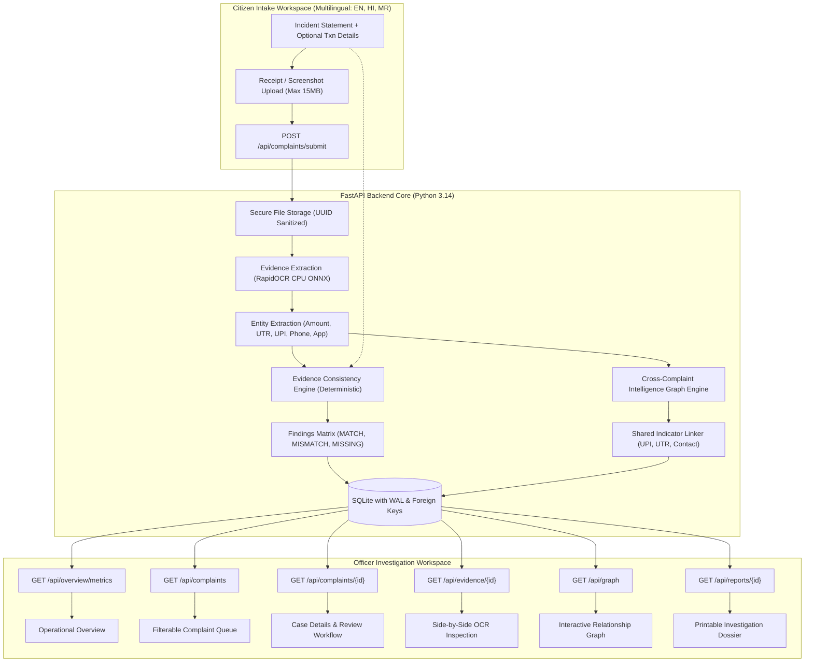

# CyberSaarthi — Cyber-Fraud Evidence Intelligence Platform

> **"From fragmented evidence to traceable cyber intelligence."**

CyberSaarthi is an integrated civic-tech platform designed to assist cyber-crime units, law enforcement officers, and triage analysts in processing fragmented, multilingual victim evidence (payment app receipts, transaction IDs, UPI handles, and statements).

The platform extracts transactional entities using local Optical Character Recognition (RapidOCR), executes deterministic consistency verifications between victim claims and receipt tokens, transparently surfaces discrepancies, and builds a cross-complaint relationship intelligence graph connecting shared indicators across isolated complaints.

---

## 1. System Architecture



---

## 2. Technology Stack & Key Dependencies

### Backend
- **Python**: 3.14.7
- **FastAPI**: 0.156.0 (High-performance async ASGI web framework)
- **Uvicorn**: 0.54.0 (Local ASGI server)
- **Pydantic**: 2.14.1 (Strict data modeling and request validation)
- **SQLite3**: Standard library, configured with WAL (Write-Ahead Logging) and `PRAGMA foreign_keys = ON`
- **RapidOCR (rapidocr-onnxruntime)**: 1.2.3 (CPU-optimized ONNX runtime OCR for local screenshot text extraction)
- **Pillow (PIL)**: 13.0.0 (Image processing, inspection, and synthetic fixture generation)
- **Pytest**: 9.1.1 (Comprehensive automated test suite)
- **HTTPX**: 0.28.1 (FastAPI TestClient backend)

### Frontend
- **React**: 19.3.1
- **TypeScript**: 6.0.3 (Strict compilation with `verbatimModuleSyntax`)
- **Vite**: 8.3.4 (Modern bundler with live `/api` proxying)
- **React Router**: 7.18.4 (Client-side routing)
- **Lucide React**: 1.60.0 (Accessible, restrained iconography)
- **Design System**: Restrained Civic-Tech CSS tokens (No cyberpunk, no neon glows, 8-pt grid, accessible color contrast)

---

## 3. Directory Layout

```
cybersaarthi/
├── README.md                   # Full documentation & run guide
├── .gitignore                  # Git ignore rules
├── .env.example                # Configuration blueprint
├── cybersaarthi.db             # Local SQLite database
├── data/
│   ├── demo_cases.json         # 5 synthetic demonstration scenarios
│   └── generate_demo_images.py # Pillow script for realistic test receipts
├── storage/
│   └── evidence/               # Safe sanitized storage for uploaded receipts
├── docs/
│   ├── architecture.md         # Detailed architectural decisions
│   ├── api-contracts.md        # API request/response contracts
│   └── test-plan.md            # Formal test specifications
├── backend/
│   ├── requirements.txt        # Python backend dependencies
│   ├── pytest.ini             # Pytest configuration
│   ├── app/
│   │   ├── main.py             # FastAPI entrypoint & router assembly
│   │   ├── core/config.py      # App settings & storage paths
│   │   ├── db/
│   │   │   ├── database.py     # SQLite connection provider
│   │   │   ├── schema.sql      # DDL database schema
│   │   │   └── init_db.py      # Idempotent DB initialization
│   │   ├── schemas/            # Pydantic request/response schemas
│   │   ├── services/
│   │   │   ├── field_normalization.py   # Currency, UPI, UTR, date normalizers
│   │   │   ├── evidence_extraction.py   # RapidOCR wrapper & entity parser
│   │   │   ├── verification_engine.py   # 6-state consistency verification engine
│   │   │   ├── intelligence_graph.py    # Cross-complaint indicator linker
│   │   │   └── report_generation.py     # Investigation-support dossier builder
│   │   └── api/                # Modular REST route handlers
│   │       ├── health.py
│   │       ├── complaints.py
│   │       ├── evidence.py
│   │       ├── overview.py
│   │       ├── graph.py
│   │       ├── reports.py
│   │       └── demo.py
│   └── tests/                  # Backend unit and integration test suite
│       ├── test_verification.py
│       ├── test_graph.py
│       └── test_api.py
└── frontend/
    ├── package.json
    ├── vite.config.ts          # Vite configuration with /api proxy
    ├── index.html
    └── src/
        ├── App.tsx             # Root router
        ├── main.tsx
        ├── styles/             # Civic-tech variables and global styling
        ├── types/              # Domain TypeScript interfaces
        ├── services/api.ts     # Frontend REST client
        ├── components/         # Badges, StatCards, ProvenancePills, Notices
        ├── layouts/            # Citizen & Officer workspaces
        └── pages/              # Intake, Overview, Queue, Details, Evidence, Graph, Reports
```

---

## 4. Synthetic Demonstration Scenarios

The platform includes 5 documented synthetic demonstration scenarios:

| Case ID | Incident Category | Stated Claim | Receipt Extraction | Expected Engine Result |
|---|---|---|---|---|
| **CS-2026-101** | UPI Electricity Bill Scam | Amount: ₹25,000<br>Txn ID: `UPI309819283741`<br>UPI: `utility.desk@okhdfcbank` | Paid ₹25,000.00<br>UPI Ref: `UPI309819283741`<br>UPI: `utility.desk@okhdfcbank` | **Exact Match (`MATCH`)** across all fields. |
| **CS-2026-102** | Work From Home Task Scam | Amount: ₹45,000<br>Txn ID: `TXN882910482910` | Paid ₹4,500.00<br>PhonePe receipt | **Amount Conflict (`MISMATCH`)**: Complaint reports ₹45,000 vs receipt showing ₹4,500. (Delta: ₹40,500). Prompts review. |
| **CS-2026-103** | Impersonation Phishing | Amount: ₹12,500<br>Txn ID: *Omitted by victim* | Paid ₹12,500.00<br>UTR: `409827384912` | **Missing in Complaint (`MISSING_IN_COMPLAINT`)**: Engine captures UTR from receipt to assist victim. |
| **CS-2026-104** | Fake Courier Delivery Fee | Amount: ₹9,800<br>UPI: `utility.desk@okhdfcbank` | Paid ₹9,800.00<br>UPI: `utility.desk@okhdfcbank` | **Shared Indicator Link**: Shares identical suspect UPI handle with **CS-2026-101**. Connected in Intelligence Graph! |
| **CS-2026-105** | Social Media Impersonation | Amount: ₹15,000<br>Txn ID: `IMPS998877665544` | Paid ₹15,000.00 | **Unrelated Isolated Case**: 0 shared links. Verifies engine does not produce spurious connections. |

---

## 5. Installation & Run Guide (Windows PowerShell)

### Prerequisites
- Python 3.10+ (Tested on Python 3.14.7)
- Node.js 18+ & npm (Tested on Node.js 24.21.0 & npm 11.19.0)

### Step 1: Backend Setup & Dependencies
Open a PowerShell terminal in the project root:
```powershell
cd cybersaarthi\backend
python -m venv .venv
.\.venv\Scripts\pip.exe install -r requirements.txt
```

### Step 2: Initialize Database & Demo Fixtures
Generate demo receipt images and initialize database tables:
```powershell
# From cybersaarthi root:
cd ..
.\backend\.venv\Scripts\python.exe -m data.generate_demo_images
.\backend\.venv\Scripts\python.exe -m app.db.init_db
```

### Step 3: Run Backend Server
```powershell
cd backend
.\.venv\Scripts\uvicorn.exe app.main:app --host 127.0.0.1 --port 8000
```
Backend API will be active at: `http://127.0.0.1:8000`  
Interactive OpenAPI documentation at: `http://127.0.0.1:8000/docs`

### Step 4: Run Frontend Client
In a second PowerShell window:
```powershell
cd cybersaarthi\frontend
npm.cmd install
npm.cmd run dev
```
Open your browser at: **`http://localhost:5173`**

---

## 6. How to Run Automated Tests

To execute the 13 backend unit and integration tests:
```powershell
cd cybersaarthi\backend
.\.venv\Scripts\python.exe -m pytest -v
```

### Test Results
```
tests/test_api.py::test_health_endpoint PASSED                           [  7%]
tests/test_api.py::test_demo_cases_endpoint PASSED                       [ 15%]
tests/test_api.py::test_complaints_list_endpoint PASSED                  [ 23%]
tests/test_api.py::test_overview_metrics_endpoint PASSED                 [ 30%]
tests/test_api.py::test_submit_complaint PASSED                          [ 38%]
tests/test_graph.py::test_shared_indicator_creates_link PASSED           [ 46%]
tests/test_verification.py::test_amount_normalization_formats PASSED     [ 53%]
tests/test_verification.py::test_upi_normalization PASSED                [ 61%]
tests/test_verification.py::test_txn_id_normalization PASSED             [ 69%]
tests/test_verification.py::test_verify_amount_match PASSED              [ 76%]
tests/test_verification.py::test_verify_amount_mismatch PASSED           [ 84%]
tests/test_verification.py::test_verify_missing_in_complaint PASSED      [ 92%]
tests/test_verification.py::test_verify_missing_in_evidence PASSED       [100%]
======================== 13 passed in 7.64s ========================
```

To verify the TypeScript frontend compilation:
```powershell
cd cybersaarthi\frontend
npm.cmd run build
```

---

## 7. 3-Minute Hackathon Demonstration Sequence

Follow this sequence to present CyberSaarthi to technical judges:

1. **Intake Flow (`/`)**:
   - Show the multilingual toggle (English / Hindi / Marathi).
   - Click **"Scenario 2: Investment Scam (₹45,000)"** in the top preset bar.
   - Point out that transaction fields are explicitly marked optional.
   - Click **"Submit Evidence for Verification"**. The backend processes the receipt through RapidOCR and issues official reference `CS-2026-XXXX`.
   - Click **"Open in Officer Workspace"**.

2. **Evidence Consistency Engine & Traceability (`/officer/complaints/cmp_demo_102`)**:
   - Show the **Evidence Consistency Verification Matrix**.
   - Point to the **Red "Discrepancy Conflict" badge**: Citizen claimed ₹45,000, but receipt extraction discovered ₹4,500 (Delta: ₹40,500).
   - Highlight the non-accusatory explanation: discrepancy does not prove forgery; it prompts the officer to ask whether multiple transfers occurred.
   - Click **"Inspect Full OCR"** to show the side-by-side evidence review console.

3. **Side-by-Side Review Console (`/officer/evidence`)**:
   - The original receipt image is rendered on the left.
   - On the right, show the raw, un-fabricated OCR text string directly from RapidOCR (with 88.5% confidence) and the structured parsed tokens.

4. **Cross-Complaint Intelligence Graph (`/officer/graph`)**:
   - Navigate to the Intelligence Graph.
   - Show how **CS-2026-101** (Electricity bill scam) and **CS-2026-104** (Courier delivery scam) are deterministically linked through the shared suspect UPI handle `utility.desk@okhdfcbank`.
   - Point out that **CS-2026-105** is isolated with 0 links (no hallucinated connections).
   - Click on the shared indicator node to inspect the provenance and connected complaints.
   - Highlight the prominent **Investigative Lead Notice**:
     *"Shared indicator detected. This relationship is an investigative lead and does not establish common ownership or criminal responsibility."*

5. **Investigation Report Dossier (`/officer/reports`)**:
   - Open the formal dossier report for **CS-2026-101**.
   - Show that it is clearly labeled as an investigation-support document, NOT a police FIR.
   - Click **"Print Dossier"** or **"Export JSON"** for export demonstration.

---

## 8. Responsible Civic-Tech Disclosures & Limitations

- **Not an Official Police FIR**: CyberSaarthi is an analytic and triage assistant. Official registration of FIRs remains under the jurisdiction of respective police departments and legal portals.
- **Human-in-the-Loop**: All algorithmic findings (OCR text, matching, graph links) are presented as investigative leads requiring officer verification before taking legal action.
- **Speech Transcription Fallback**: While designed for multilingual audio intake, when external heavy ASR foundation models (Whisper) are omitted for lightweight CPU execution, the platform provides a full written narrative intake with multilingual script support.
- **Local Prototype Authentication**: In this prototype, role-based authentication is streamlined to facilitate judge evaluation without login barriers. In production, multi-factor authentication (MFA) and granular audit logging should be enforced.
