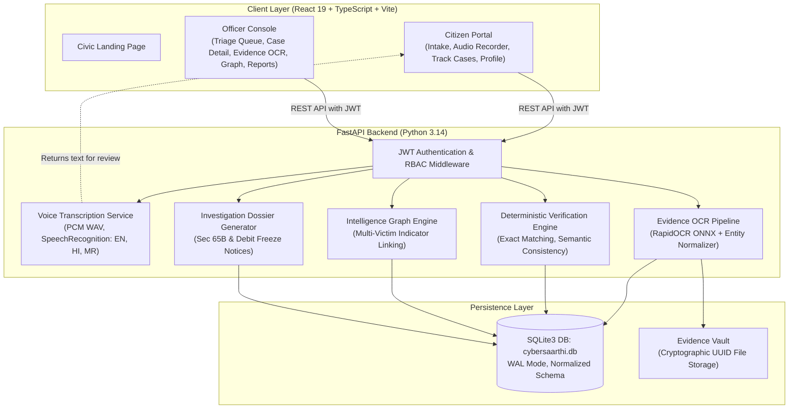

# CyberSaarthi System Architecture

## 1. Executive Summary

CyberSaarthi is an evidence intelligence, verification, and investigation-support platform designed to assist cybercrime cells and citizens in handling cyber fraud complaints. The system processes multilingual victim statements, in-browser recorded audio, and payment transaction receipts/screenshots. It extracts transactional entities using local RapidOCR, executes deterministic cross-checks, identifies cross-complaint syndicate links, and prepares Section 65B-ready investigation dossiers.

---

## 2. High-Level Architecture Diagram

---

## 3. Core Architectural Pillars

1. **Strict Persona Segregation**:
   - **Citizen Portal**: Clean, accessible citizen journey for filing complaints, recording voice statements in-browser, tracking case lifecycle stages, and managing account credentials. Sensitive police leads and notes are automatically redacted.
   - **Officer Workspace**: Access-controlled law enforcement console for triaging incoming complaints, inspecting high-resolution receipts alongside raw OCR tokens, conducting manual field corrections with immutable audit provenance, exploring multi-victim syndicate graphs, and issuing bank freeze notices.
2. **Direct In-Browser Voice Statement Capture**:
   - Uses browser Web Audio API / `MediaRecorder` to capture audio.
   - Automatically transcodes raw float samples into 16kHz mono 16-bit PCM WAV in the browser, eliminating external ffmpeg requirements.
   - Server-side speech-to-text pipeline transcribes English, Hindi, and Marathi.
   - Citizens inspect and edit transcripts before complaint registration.
3. **Deterministic Verification (Non-Hallucinatory)**:
   - Financial and identifier comparisons strictly execute deterministic Python business rules.
   - Decimal arithmetic avoids floating-point roundoff errors.
   - Six distinct verification outcomes: `MATCH`, `MISMATCH`, `MISSING_IN_COMPLAINT`, `MISSING_IN_EVIDENCE`, `UNABLE_TO_VERIFY`, `MANUAL_REVIEW_REQUIRED`.
4. **Field Provenance & Manual Correction**:
   - Original RapidOCR tokens are permanently preserved.
   - Officers can correct OCR extraction inaccuracies; the system stores original values, officer identity, timestamp, and audit reason, and automatically recomputes verification consistency.
5. **Multi-Victim Intelligence Graph**:
   - Automatically indexes UPI handles, phone numbers, and bank accounts.
   - Discovers shared indicators across independent citizen filings.
   - Disclaims all correlations as investigative leads, not legal guilt.

---

## 4. Component Details

### 4.1 Frontend Architecture (`frontend/src/`)
- **Technology**: React 19, TypeScript, Vite, React Router v7, Lucide Icons.
- **Components**:
  - `VoiceRecorder.tsx`: In-browser recording with timer, waveforms, WAV encoder, audio playback, language selector, and transcription trigger.
  - `Header.tsx`: Role-aware header displaying active authenticated user, health pill, and portal navigation.
  - `DiscrepancyBadge.tsx`: Color-coded semantic badges for verification statuses.
  - `ProvenancePill.tsx`: Source attribution (`Citizen Reported`, `OCR Token`, `Officer Corrected`, `Deterministic Engine`).
- **Routing & Guards**:
  - `RequireCitizen`: Route guard protecting citizen dashboard, new complaint form, and tracking pages.
  - `RequireOfficer`: Route guard protecting officer queue, case details, OCR inspection, graph, and reports.

### 4.2 Backend Architecture (`backend/app/`)
- **Technology**: FastAPI, Pydantic v2, Uvicorn, Python 3.14.
- **Modules**:
  - `core/security.py`: PBKDF2 hashing, JWT generation and verification, `get_current_user`, `require_role`.
  - `services/voice_transcription.py`: Multilingual speech recognition with silence and noise handling.
  - `services/evidence_extraction.py`: RapidOCR ONNX inference and entity regex parsers.
  - `services/field_normalization.py`: UPI, Phone, Currency, and Datetime normalizers.
  - `services/verification_engine.py`: Deterministic verification rules.
  - `services/intelligence_graph.py`: Graph node-edge generator and indicator indexer.
  - `services/report_generation.py`: Formal investigation dossier assembler.

### 4.3 Database Architecture (`cybersaarthi.db`)
- Normalized SQLite relational database operating with Write-Ahead Logging (`WAL`).
- Automated schema migrations via `init_db.py`.
- Foreign key constraints enabled (`PRAGMA foreign_keys = ON`).
