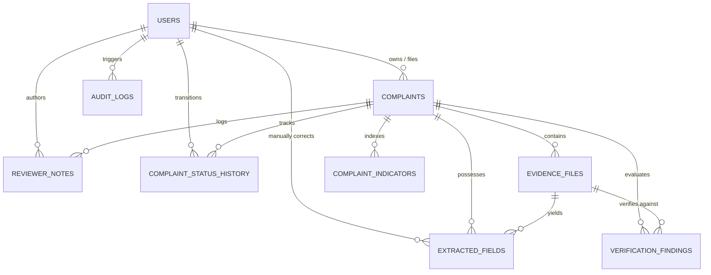

# CyberSaarthi Data Dictionary

This document details the normalized relational database schema, table structures, column definitions, data types, constraints, and relational integrity rules implemented in `CyberSaarthi` (`SQLite3` with WAL mode enabled).

---

## 1. Schema Overview

---

## 2. Table Specifications

### 2.1 Table: `users`
Stores authenticated user records for both Citizen and Police Officer / Admin personas.

| Column Name | SQLite Type | Nullable | Primary Key | Default | Description / Constraints |
| :--- | :--- | :--- | :--- | :--- | :--- |
| `id` | `TEXT` | No | Yes | — | Unique identifier (`usr_<12hex>`) |
| `email` | `TEXT` | No | No | — | Unique lowercase user email address (`UNIQUE`) |
| `password_hash` | `TEXT` | No | No | — | PBKDF2-HMAC-SHA256 hash formatted as `pbkdf2:sha256:100000$<salt>$<hash>` |
| `full_name` | `TEXT` | No | No | — | Full legal or display name |
| `phone` | `TEXT` | Yes | No | `NULL` | Registered contact phone number |
| `role` | `TEXT` | No | No | `'CITIZEN'` | Role enumeration: `'CITIZEN'`, `'OFFICER'`, `'ADMIN'` |
| `is_active` | `INTEGER` | No | No | `1` | Boolean active flag (0=Disabled, 1=Active) |
| `created_at` | `TEXT` | No | No | `CURRENT_TIMESTAMP` | ISO 8601 registration timestamp |
| `updated_at` | `TEXT` | No | No | `CURRENT_TIMESTAMP` | ISO 8601 modification timestamp |

---

### 2.2 Table: `complaints`
Primary entity storing citizen cyber fraud incident reports.

| Column Name | SQLite Type | Nullable | Primary Key | Default | Description / Constraints |
| :--- | :--- | :--- | :--- | :--- | :--- |
| `id` | `TEXT` | No | Yes | — | Canonical complaint ID (`cmp_<12hex>`) |
| `reference_id` | `TEXT` | No | No | — | Human-readable tracking number (e.g., `CR-2026-0312-9842`, `UNIQUE`) |
| `user_id` | `TEXT` | Yes | No | `NULL` | Foreign key referencing `users(id)` ON DELETE SET NULL |
| `submission_time` | `TEXT` | No | No | — | ISO 8601 submission timestamp |
| `language` | `TEXT` | No | No | `'en'` | Complaint filing language code (`'en'`, `'hi'`, `'mr'`) |
| `incident_type` | `TEXT` | No | No | — | Categorized fraud type (e.g., `UPI Fraud`, `Job Scam`) |
| `description` | `TEXT` | No | No | — | Citizen's factual narrative statement |
| `reported_amount` | `REAL` | Yes | No | `NULL` | Disputed loss amount claimed by victim |
| `reported_txn_id` | `TEXT` | Yes | No | `NULL` | Claimed Bank UTR / Transaction Reference ID |
| `reported_upi_id` | `TEXT` | Yes | No | `NULL` | Claimed suspect UPI VPA handle |
| `incident_datetime`| `TEXT` | Yes | No | `NULL` | Estimated incident occurrence timestamp |
| `victim_phone` | `TEXT` | Yes | No | `NULL` | Contact phone reported by complainant |
| `victim_state` | `TEXT` | Yes | No | `NULL` | State / Police jurisdiction of victim |
| `status` | `TEXT` | No | No | `'AWAITING_REVIEW'` | Incident lifecycle status |
| `priority` | `TEXT` | No | No | `'MEDIUM'` | Triage priority (`'CRITICAL'`, `'HIGH'`, `'MEDIUM'`, `'LOW'`) |
| `is_demo` | `INTEGER` | No | No | `0` | Boolean flag (0=Live/User, 1=Synthetic Seed) |
| `created_at` | `TEXT` | No | No | `CURRENT_TIMESTAMP` | Creation timestamp |
| `updated_at` | `TEXT` | No | No | `CURRENT_TIMESTAMP` | Last updated timestamp |

---

### 2.3 Table: `evidence_files`
Metadata and raw OCR extraction outputs for uploaded payment receipts and screenshots.

| Column Name | SQLite Type | Nullable | Primary Key | Default | Description / Constraints |
| :--- | :--- | :--- | :--- | :--- | :--- |
| `id` | `TEXT` | No | Yes | — | Unique evidence ID (`ev_<12hex>`) |
| `complaint_id` | `TEXT` | No | No | — | Foreign key referencing `complaints(id)` ON DELETE CASCADE |
| `original_filename`| `TEXT` | No | No | — | Sanitized original client filename |
| `storage_filename` | `TEXT` | No | No | — | Non-guessable storage UUID filename on disk |
| `file_type` | `TEXT` | No | No | — | MIME type (`image/png`, `image/jpeg`, `application/pdf`) |
| `file_size_bytes` | `INTEGER` | No | No | — | Byte size of stored payload |
| `ocr_status` | `TEXT` | No | No | `'PENDING'` | Status: `'PENDING'`, `'COMPLETED'`, `'FAILED'` |
| `raw_ocr_text` | `TEXT` | Yes | No | `NULL` | Complete raw text parsed by RapidOCR |
| `ocr_confidence` | `REAL` | Yes | No | `NULL` | Aggregated OCR confidence (0.00 to 1.00) |
| `created_at` | `TEXT` | No | No | `CURRENT_TIMESTAMP` | Upload timestamp |

---

### 2.4 Table: `extracted_fields`
Structured entities parsed from OCR text or manual officer corrections.

| Column Name | SQLite Type | Nullable | Primary Key | Default | Description / Constraints |
| :--- | :--- | :--- | :--- | :--- | :--- |
| `id` | `TEXT` | No | Yes | — | Field identifier (`ef_<12hex>`) |
| `evidence_id` | `TEXT` | No | No | — | Foreign key referencing `evidence_files(id)` ON DELETE CASCADE |
| `complaint_id` | `TEXT` | No | No | — | Foreign key referencing `complaints(id)` ON DELETE CASCADE |
| `field_name` | `TEXT` | No | No | — | Entity name: `'amount'`, `'txn_id'`, `'upi_id'`, `'timestamp'` |
| `raw_value` | `TEXT` | Yes | No | `NULL` | Unprocessed extracted token string |
| `normalized_value` | `TEXT` | Yes | No | `NULL` | Clean canonical representation (e.g., standard UPI, decimal) |
| `confidence` | `REAL` | Yes | No | `NULL` | Model extraction confidence |
| `source_context` | `TEXT` | Yes | No | `NULL` | Bounding line context surrounding token |
| `is_officer_corrected` | `INTEGER` | No | No | `0` | Provenance flag: 1 if manually corrected |
| `original_value` | `TEXT` | Yes | No | `NULL` | Immutable snapshot of pre-correction value |
| `corrected_by_user_id` | `TEXT` | Yes | No | `NULL` | FK referencing `users(id)` of correcting officer |
| `correction_reason` | `TEXT` | Yes | No | `NULL` | Audit justification logged by officer |
| `created_at` | `TEXT` | No | No | `CURRENT_TIMESTAMP` | Creation/correction timestamp |

---

### 2.5 Table: `verification_findings`
Deterministic comparison findings evaluating citizen claims against OCR receipt tokens.

| Column Name | SQLite Type | Nullable | Primary Key | Default | Description / Constraints |
| :--- | :--- | :--- | :--- | :--- | :--- |
| `id` | `TEXT` | No | Yes | — | Finding ID (`vf_<12hex>`) |
| `complaint_id` | `TEXT` | No | No | — | FK referencing `complaints(id)` ON DELETE CASCADE |
| `evidence_id` | `TEXT` | Yes | No | `NULL` | FK referencing `evidence_files(id)` ON DELETE CASCADE |
| `field_name` | `TEXT` | No | No | — | Entity evaluated (`'amount'`, `'txn_id'`, `'upi_id'`) |
| `complaint_value` | `TEXT` | Yes | No | `NULL` | Complainant stated value |
| `evidence_value` | `TEXT` | Yes | No | `NULL` | Receipt extracted value |
| `result` | `TEXT` | No | No | — | Consistency status code |
| `reason` | `TEXT` | No | No | — | Factual rule-based justification |
| `review_recommendation` | `TEXT` | No | No | — | Operational advisory for officer |
| `created_at` | `TEXT` | No | No | `CURRENT_TIMESTAMP` | Verification timestamp |

---

### 2.6 Table: `complaint_indicators`
Indexed suspicious tokens powering the multi-complaint Intelligence Graph.

| Column Name | SQLite Type | Nullable | Primary Key | Default | Description / Constraints |
| :--- | :--- | :--- | :--- | :--- | :--- |
| `id` | `TEXT` | No | Yes | — | Indicator link ID (`ind_<12hex>`) |
| `complaint_id` | `TEXT` | No | No | — | FK referencing `complaints(id)` ON DELETE CASCADE |
| `indicator_type` | `TEXT` | No | No | — | Type: `'UPI_ID'`, `'PHONE'`, `'BANK_ACCOUNT'` |
| `raw_value` | `TEXT` | No | No | — | Original token string |
| `normalized_value` | `TEXT` | No | No | — | Canonical lookup key (`UNIQUE(complaint_id, indicator_type, normalized_value)`) |
| `source` | `TEXT` | No | No | — | Provenance source: `'COMPLAINT_STATEMENT'`, `'OCR_RECEIPT'` |
| `created_at` | `TEXT` | No | No | `CURRENT_TIMESTAMP` | Creation timestamp |

---

### 2.7 Table: `complaint_status_history`
Chronological state transition log for each complaint.

| Column Name | SQLite Type | Nullable | Primary Key | Default | Description / Constraints |
| :--- | :--- | :--- | :--- | :--- | :--- |
| `id` | `TEXT` | No | Yes | — | Status history ID (`csh_<12hex>`) |
| `complaint_id` | `TEXT` | No | No | — | FK referencing `complaints(id)` ON DELETE CASCADE |
| `old_status` | `TEXT` | Yes | No | `NULL` | Prior status string |
| `new_status` | `TEXT` | No | No | — | New status string |
| `changed_by_user_id` | `TEXT` | Yes | No | `NULL` | FK referencing `users(id)` |
| `reason` | `TEXT` | Yes | No | `NULL` | Transition justification |
| `created_at` | `TEXT` | No | No | `CURRENT_TIMESTAMP` | Event timestamp |

---

### 2.8 Table: `reviewer_notes`
Official investigative notes and triage decisions recorded by police officers.

| Column Name | SQLite Type | Nullable | Primary Key | Default | Description / Constraints |
| :--- | :--- | :--- | :--- | :--- | :--- |
| `id` | `TEXT` | No | Yes | — | Note ID (`rn_<12hex>`) |
| `complaint_id` | `TEXT` | No | No | — | FK referencing `complaints(id)` ON DELETE CASCADE |
| `user_id` | `TEXT` | Yes | No | `NULL` | FK referencing `users(id)` |
| `reviewer_name` | `TEXT` | No | No | — | Officer badge / title |
| `note` | `TEXT` | No | No | — | Substantive case note / instruction |
| `review_status` | `TEXT` | No | No | — | Associated case status |
| `created_at` | `TEXT` | No | No | `CURRENT_TIMESTAMP` | Log timestamp |

---

### 2.9 Table: `audit_logs`
Immutable security and administrative event ledger.

| Column Name | SQLite Type | Nullable | Primary Key | Default | Description / Constraints |
| :--- | :--- | :--- | :--- | :--- | :--- |
| `id` | `TEXT` | No | Yes | — | Audit log ID (`aud_<12hex>`) |
| `user_id` | `TEXT` | Yes | No | `NULL` | FK referencing `users(id)` |
| `action` | `TEXT` | No | No | — | Event: `'LOGIN'`, `'COMPLAINT_SUBMIT'`, `'FIELD_CORRECTED'` |
| `resource_type` | `TEXT` | Yes | No | `NULL` | Resource class: `'complaint'`, `'evidence'`, `'auth'` |
| `resource_id` | `TEXT` | Yes | No | `NULL` | Affected primary key |
| `details` | `TEXT` | Yes | No | `NULL` | JSON stringified metadata |
| `ip_address` | `TEXT` | Yes | No | `NULL` | Client IP address |
| `created_at` | `TEXT` | No | No | `CURRENT_TIMESTAMP` | Event timestamp |
